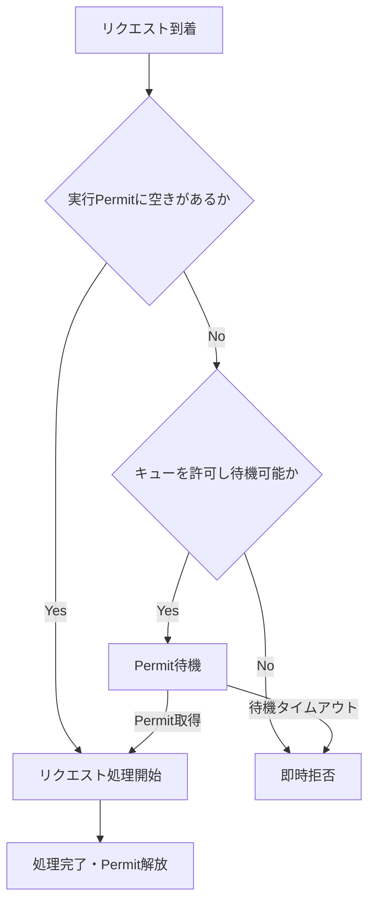

# Helidon 4 WebServer の同時実行制御：即時拒否と FixedLimit キューの比較

**調査レポート** | 作成日：2026-10-27 | 対象：Helidon 4.5.4 の公開ドキュメント／JavaDoc、および既存の Python 離散イベントシミュレーション

> **位置づけ**：設定仕様は Helidon 公式ドキュメントで確認した事項。性能値は Helidon 実機のベンチマークではなく、単純化したシミュレーション結果である。両者を混同しない。

## エグゼクティブサマリー

1. **`max-concurrent-requests` と `concurrency-limit.fixed` は別々のアルゴリズムではない。** `max-concurrent-requests` の設定時も内部では `FixedLimit` が使用され、同じリスナーに `concurrency-limit` を設定しても後者は無視される [S2]。
2. **実質的な比較軸は「キューなしの即時拒否」対「キューありの待機」**。`fixed.queue-length` の既定値は `0`（キューなし）、待機を有効化した場合の `queue-timeout` の既定値は `PT1S` [S1][S3]。
3. **短時間バーストでは有限の待機が有利**。今回のモデルでは、期限内成功率はキューなしの **82.4%** から、キュー長40で **92.6%** に改善した。
4. **持続的過負荷では深いキューが有害になり得る**。同じモデルでキューなしは **61.0%**、キュー長10は **69.0%**、キュー長40は **0.8%** の期限内成功率になった。最後のケースはサーバーの処理完了率だけなら約69.6%であり、*完了数とユーザーにとって有効な成功数が異なる*ことを示す。
5. したがって **「キューは常によい」「即時拒否が常によい」のいずれも成り立たない**。目標は拒否率の最小化ではなく、**期限内成功数（goodput）の最大化、P95/P99と下流資源の保護**である。

## 1. 対象機能と設定上の相違

### 1.1 仕様比較

| 設定 | 実行中の要求数の上限 | 上限到達時 | 補足 |
|---|---:|---|---|
| `server.max-concurrent-requests: 10` | 10 | 原則として待機キューを持たず拒否 | `FixedLimit` を使用。`concurrency-limit` に優先する [S2] |
| `server.concurrency-limit.fixed.permits: 10` | 10 | キューなし（既定値）なので拒否 | `queue-length=0` [S1][S3] |
| `fixed.permits: 10` + `queue-length: 20` | 10 | Permit を待機し、空き次第実行 | 空きがない／待機タイムアウト時は拒否 [S1] |
| `fixed.permits: 10` + `queue-length: 20` + `queue-timeout: PT0.1S` | 10 | 100ms まで Permit を待機 | **待機だけ**の上限。処理全体の締切ではない [S3] |

**重要な優先順位：** `max-concurrent-requests` を設定すると、同じリスナーに明示した `concurrency-limit` が無視される [S2]。待機キューを評価するときは `max-concurrent-requests` を併記しない。

また、設定場所によって適用範囲が異なる。`server.concurrency-limit` は WebServer リスナー単位に作用し、`server.features.limits.concurrency-limit` はルーティング後の HTTP リクエストに作用する [S1]。

### 1.2 判定フロー



上図は理解用の概念フロー。**実装の待機キュー長は厳密な固定容量とは限らない**。Helidon JavaDoc は内部で `Semaphore.getQueueLength()` を参照すること、および並行実行時には `queue-length` が正確な上限にならない可能性を明記している [S3]。後述するシミュレーターはこれと異なり、ハードな上限を持つ FIFO キューを使う。

### 1.3 比較に使用する YAML の例

**A. 即時拒否（簡易設定）**

```yaml
server:
  max-concurrent-requests: 10
```

**B. FixedLimit、キューなし（同等の比較条件）**

```yaml
server:
  concurrency-limit:
    fixed:
      permits: 10
      queue-length: 0
      enable-metrics: true
```

**C. FixedLimit、短い待機を許容**

```yaml
server:
  concurrency-limit:
    fixed:
      permits: 10
      queue-length: 10
      queue-timeout: PT0.1S
      fair: true
      enable-metrics: true
```

この数値は**検証開始用の例**であり、推奨固定値ではない。`fair: true` はシミュレーションで採用した FIFO を近似するための明示設定（Helidon の既定値は `false` [S3]）。

## 2. シミュレーション設計

### 2.1 共通条件

| 項目 | 仮定 |
|---|---|
| モデル | Python の離散イベントモデル（Helidon/JVM を起動しない） |
| 実行 Permit | `C = 10` |
| 通常リクエスト処理時間 | 対数正規分布、平均約80ms、対数標準偏差 `σ=0.25` |
| 公称処理能力 | `10 / 0.080 = 約125 req/s`（単純近似） |
| 待機方式 | FIFO、待機キューの容量は厳密に `Q` 件 |
| 基本の待機タイムアウト | **600ms**（実験独自の設定。Helidon の既定値ではない） |
| 比較したキュー長 | `Q = 0, 2, 5, 10, 15, 20, 25, 30, 35, 40, 50, 60` |
| 乱数 | NumPy、`seed=42`。同じシナリオ内では到着時刻とサービス時間を全設定で共通化 |
| 対象外 | リトライ、実際の通信遅延、GC、CPU/DB競合、ロードバランサー、クライアント切断による処理中止、アプリケーションの内部キュー |

### 2.2 負荷パターン

| シナリオ | リクエスト到着 | 処理時間 | クライアント締切 |
|---|---|---|---:|
| **A. 短時間バースト** | 65req/s を60秒、5秒ごとに300msだけ +300req/s | 平均80ms | 420ms |
| **B. 持続的過負荷** | 180req/s を40秒継続（公称125req/s超） | 平均80ms | 250ms |
| **C. 長い処理の混在** | 76req/s を50秒、8秒ごとに350msだけ +190req/s | 80%が平均40ms、20%が平均360ms | 280ms |

到着件数はそれぞれ **4,938件／7,272件／4,246件**。到着は該当時間帯内の Poisson 件数と一様な到着時刻を用いて生成した。

### 2.3 指標の定義

- **処理完了率** = `サーバーで処理を完了した件数 / 全到着件数`
- **期限内成功率（goodput比率）** = `クライアント締切までに処理完了した件数 / 全到着件数`
- **拒否率** = `Permit/キュー取得を拒否された件数 / 全到着件数`
- **P95/P99レイテンシー** = `到着 → 処理完了` の時間の分位点。**サーバーで処理完了したものだけ**を対象とし、遅延完了は含むが、拒否された要求は含まない。

特に本モデルは、クライアントの締切後もサーバー側で処理を続ける。実システムの切断／キャンセル処理によってはこの結果は変わる。

## 3. 結果

### 3.1 期限内成功率


| シナリオ | Q=0：即時拒否 | 有利な有限キュー | 過大なキュー |
|---|---:|---:|---:|
| 短時間バースト | **82.4%**（4,067/4,938） | **92.6%**（Q=40、4,572件） | 85.7%（Q=60） |
| 持続的過負荷 | **61.0%**（4,436/7,272） | **69.0%**（Q=10、5,020件） | **0.8%**（Q=40、59件） |
| 長い処理が混在 | **68.1%**（2,893/4,246） | **75.9%**（Q=15、3,222件） | **65.4%**（Q=60） |

良好なキュー設定と Q=0 の期限内成功率の差は、バーストで約 **+10.2 ポイント**、持続的過負荷で **+8.0 ポイント**、長い処理の混在で **+7.7 ポイント**だった。ただしこれは各シナリオ・乱数シードに特有の値であり、一般的な Helidon の性能向上率を表さない。

### 3.2 サーバー完了率と期限内成功率の乖離

| シナリオ／設定 | サーバー処理完了率 | 期限内成功率 | 期限後に処理完了した件数 |
|---|---:|---:|---:|
| バースト、Q=0 | 82.4% | 82.4% | 0 |
| バースト、Q=40 | 93.1% | 92.6% | 24 |
| 過負荷、Q=0 | 61.0% | 61.0% | 0 |
| 過負荷、Q=10 | 69.1% | 69.0% | 2 |
| **過負荷、Q=40** | **69.6%** | **0.8%** | **5,005** |
| 長い処理混在、Q=15 | 93.1% | 75.9% | 729 |

**最も重要な観察：** サーバーが処理を完了したからといって、クライアントが期限内に結果を受け取れたとは限らない。過大キューは、拒否率の低下と引き換えに、大量の無効な遅延処理を生み得る。

### 3.3 レイテンシー


| シナリオ | 設定 | P95 | P99 |
|---|---|---:|---:|
| バースト | Q=0 | 118ms | 138ms |
| バースト | Q=40 | 369ms | 409ms |
| バースト | Q=60 | 500ms | 552ms |
| 過負荷 | Q=0 | 115ms | 137ms |
| 過負荷 | Q=5 | 150ms | 176ms |
| 過負荷 | Q=10 | 190ms | 214ms |
| 過負荷 | Q=40 | 432ms | 455ms |
| 長い処理混在 | Q=0 | 411ms | 535ms |
| 長い処理混在 | Q=15 | 468ms | 598ms |
| 長い処理混在 | Q=60 | 602ms | 836ms |

**読み方への注意：** ここでの P95/P99 は、処理完了した要求を母集団とした値であり、全到着要求の P95/P99 ではない。特に長い処理混在の P95 が締切280msを超えるのは、期限後に処理完了した要求も集計しているためである。Q=0 の小さい P95 も「全クライアントが速かった」ことを意味しない（拒否された要求を除外している）。

## 4. 結果の解釈

### 4.1 なぜ短時間バーストでキューが有利なのか

短時間だけ到着率が処理能力を超えても、その後に到着率が下がればバックログを消化できる。待機時間がクライアント締切を超えなければ、**本来拒否される要求を期限内に救済できる**。

### 4.2 なぜ持続的過負荷でキューが有害なのか

到着率 `λ=180req/s` が公称処理能力 `μ≈125req/s` を継続して超えると、待機は一時的なバースト吸収ではなく恒常的な滞留になる。

飽和時にキュー末尾へ入った要求の**粗い待ち時間目安**は以下のとおり：

\[
\mu \approx \frac{C}{E[S]} = \frac{10}{0.08\,\mathrm{s}} = 125\ \mathrm{req/s}
\]

\[
W_q \approx \frac{Q}{\mu}
\]

| Q | キュー末尾の概算待機時間 |
|---:|---:|
| 5 | 40ms |
| 10 | 80ms |
| 20 | 160ms |
| 40 | 320ms |

期限250msの要求が320ms待機すれば、実処理を開始する前に期限切れになる。さらに、遅延完了した処理は Permit を使用し続けるため、後続要求の救済機会も減る。この概算式は確率的待ち時間の厳密解ではなく、実測値でもない。

### 4.3 待機タイムアウトが効くケース

持続的過負荷に対してキュー長 Q=40 を固定し、**Permit の待機タイムアウトだけ**変更した追加シミュレーション：

| Q | 待機タイムアウト | 処理完了率 | 期限内成功率 | P95（完了分） |
|---:|---:|---:|---:|---:|
| 0 | — | 61.0% | 61.0% | 115ms |
| 40 | 600ms | 69.6% | **0.8%** | 432ms |
| 40 | 100ms | 69.6% | **69.4%** | 206ms |
| 40 | 50ms | 69.3% | **69.3%** | 156ms |

待機タイムアウトを短くすると、期限に間に合う見込みの低いリクエストを早期に落とせる。ただし固定の待機タイムアウトだけでは個々のクライアント締切や実処理時間を認識できない。

## 5. 運用上の設計指針

### 5.1 キュー長だけでなく、許容時間から決める

最初にクライアント側の締切 `D` を定義し、ネットワークや処理本体、余裕時間を差し引いて Permit 待機に使える時間を見積もる。

\[
T_{queue,budget} \lesssim D - T_{network} - T_{service,tail} - T_{safety}
\]

例えば期限250ms、処理時間の P95 が120ms、通信・安全余裕に30ms見込む場合、**待機予算は約100ms**となる。ここから `queue-timeout` を検討し、キュー長を負荷試験で調整する。これは設定の検討手順であり、100ms が普遍的に最適という意味ではない。

### 5.2 ワークロード別の方向性

| 状況 | 検討する方式 | 理由 |
|---|---|---|
| 非常に厳しい締切、速い失敗・リトライ可能 | 即時拒否、または極小キュー | 無効な待機時間を増やさない |
| 数百ms単位の突発的バースト、後続に余力 | 小～中程度の有限キュー | 短時間の過負荷を平滑化できる |
| 長時間にわたり到着率が処理能力を超える | 小キュー＋短い待機タイムアウト、上流の負荷制御 | キューに溜めても安定的には解決しない |
| 下流DBや接続プールがボトルネック | DB能力に基づく Permit 設定、別途DBプール制限 | 仮想スレッドが大量に作れても下流能力は有限 |
| 負荷により安全な同時実行数が大きく変動 | Fixed に加え AIMD も評価 | Helidon は測定された処理時間を用いた適応制御を提供 [S1] |

### 5.3 計測すべきメトリクス

Helidon FixedLimit の標準指標 [S1]：

| 指標 | 用途 |
|---|---|
| `fixed_concurrent_requests` | 実行中リクエスト数 |
| `fixed_queue_length` | 待機中リクエスト数 |
| `fixed_rejected_requests` | 拒否累積数 |
| `fixed_queue_wait_time` | Permit の待機時間 |
| `fixed_rtt` | **キュー待ち時間を除外**した処理時間 |

これらとは別に、クライアント／LB側で **エンドツーエンドの P50/P95/P99、締切以内の成功件数、拒否件数、リトライ率、キャンセル件数**を記録する。`fixed_rtt` だけを見ていると、待機が長くなる問題を見落とす。

## 6. 制約と実機検証事項

本結果を Helidon の設定値としてそのまま本番適用することは推奨しない。主な制約は次のとおり。

1. **実装差**：シミュレーターは FIFO の厳密な長さのキュー。Helidon `FixedLimit` は `Semaphore.getQueueLength()` を用い、並行負荷下では実際のキュー長が厳密な制限と一致しない場合がある [S3]。既定の公平性も異なる。
2. **負荷に依存した処理時間悪化なし**：DB接続枯渇、ロック競合、GC、CPU飽和などをモデル化していない。こうした条件ではキューのデメリットが増幅する可能性がある。
3. **リトライ／切断キャンセルなし**：即時拒否後のリトライ増幅や、期限超過時の処理中断を再現していない。期限内成功数の優劣も変わり得る。
4. **1回の乱数系列**：シード42の単一試行。統計的な信頼区間・複数シード・到着パターンの感度分析を行っていない。
5. **HTTPレイヤー未検証**：拒否時の実際のHTTPステータス、接続再利用、HTTP/2、LBタイムアウト、パケットキューイングへの影響は未測定。

**次の実験**として、Helidon 4.5.4 の実アプリケーションで、`Q=0,5,10,20,40` と `queue-timeout=50/100/200/600ms` を網羅的に比較し、k6／wrk2等で open-loop の到着を再現する。実測の Deadline goodput、P95/P99、拒否、DBプール使用量を同時測定するのがよい。また、同一条件で AIMD と Fixed を比較する。

## 7. 再現方法と成果物

同じディレクトリに以下のファイルを配置する。

```text
Helidon_Concurrency_Limits_調査レポート.md
helidon_concurrency_sim.py
plot_helidon_concurrency.py
helidon_concurrency_results.csv
helidon_queue_success.png
helidon_queue_p95.png
```

```bash
python -m pip install numpy matplotlib
python helidon_concurrency_sim.py
python plot_helidon_concurrency.py
```

2つめのスクリプトは前回の実験で `/mnt/data/` に CSV とPNGを出力する仕様である。別のディレクトリで再実行する場合は、`plot_helidon_concurrency.py` 中の出力先を適宜変更する。

## 参考資料

- **[S1]** Helidon 4.5.4, *Concurrency Limits* — https://helidon.io/docs/v4/se/webserver/concurrency-limits
- **[S2]** Helidon 4.5.4 JavaDoc, *ListenerConfig* (`maxConcurrentRequests`, `concurrencyLimit`) — https://helidon.io/docs/v4/apidocs/io.helidon.webserver/io/helidon/webserver/ListenerConfig.html
- **[S3]** Helidon 4.5.4 JavaDoc, *FixedLimitConfig*（キュー長、タイムアウト、公平性、`Semaphore.getQueueLength()`）— https://helidon.io/docs/v4/apidocs/io.helidon.common.concurrency.limits/io/helidon/common/concurrency/limits/FixedLimitConfig.html
- **[S4]** Helidon 4.5.4, *WebServer*（構成キー）— https://helidon.io/docs/v4/se/webserver

---

**最終結論：** `max-concurrent-requests` 対 `fixed` という設定名称の二択ではなく、**拒否・待機・タイムアウトを合わせた Admission Control の設計問題**として扱うべきである。短いバーストには限定的なキューが有用だが、持続的過負荷ではクライアントの締切より長い待機が goodput を壊す。チューニングの基準は、拒否率よりも**期限内成功数・実際のエンドツーエンドレイテンシー・下流への負荷**とする。
